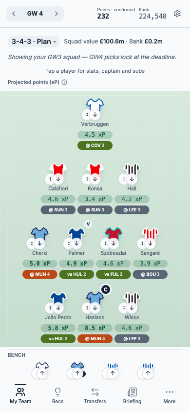
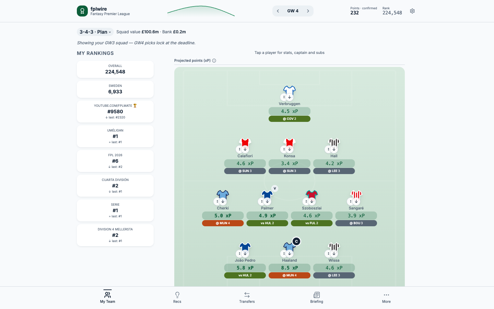
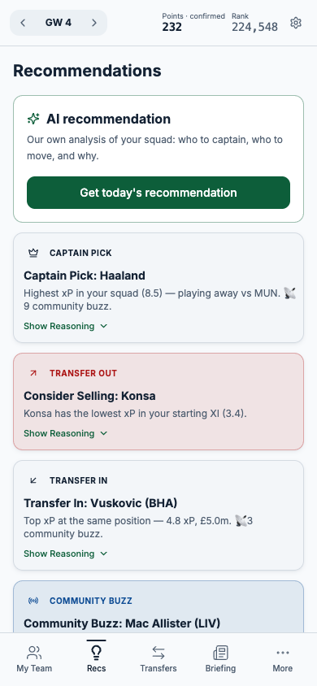
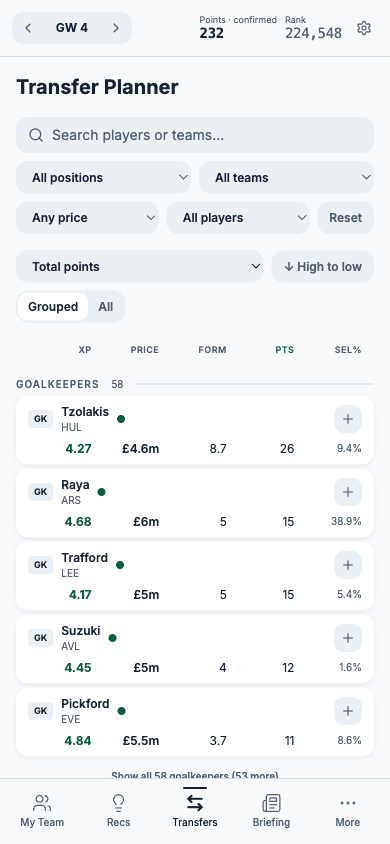
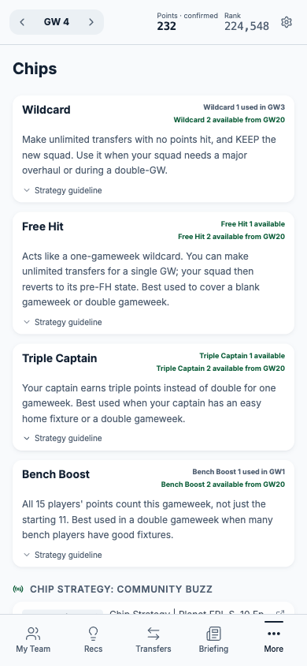
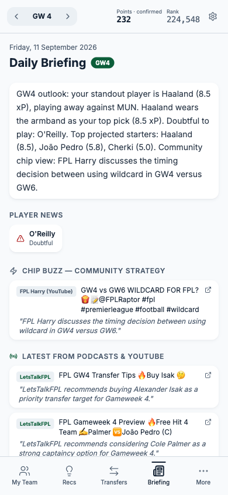
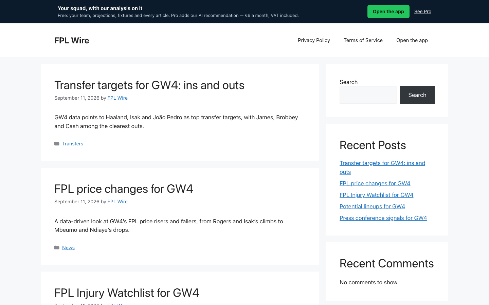
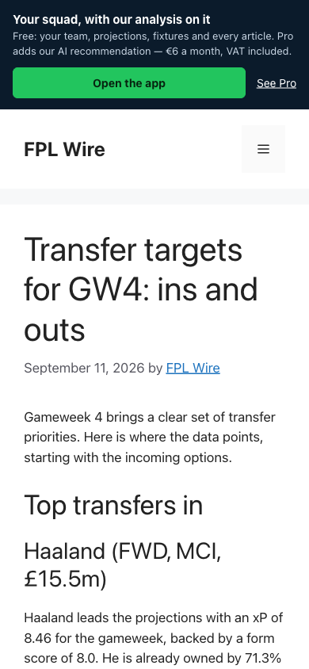
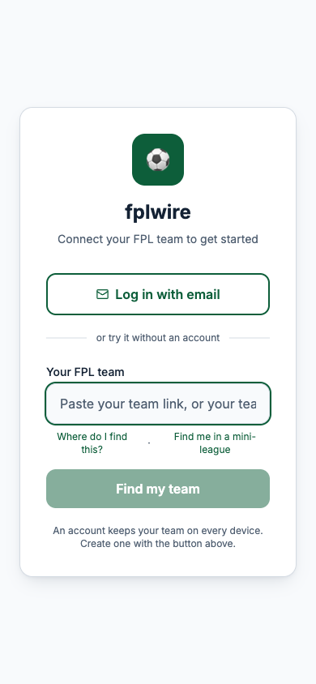
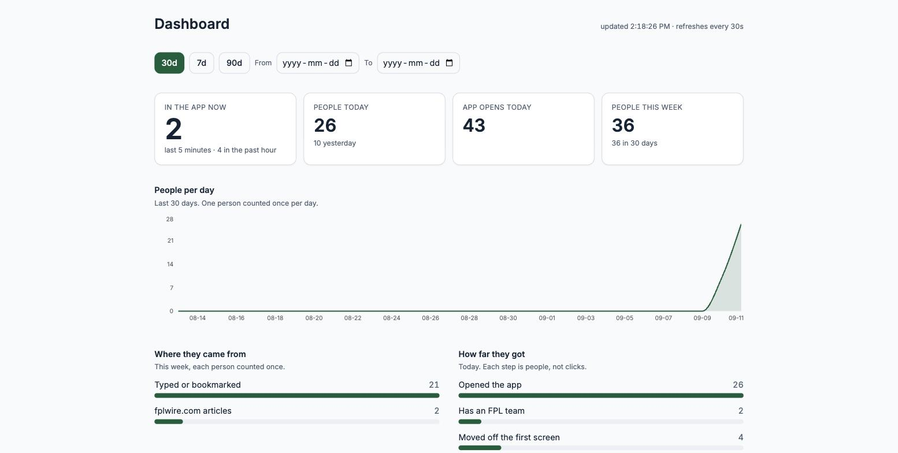

# What Ehsan has built: fplwire

**fplwire is a free helper for people who play Fantasy Premier League (FPL).**
It is a website, [fplwire.com](https://www.fplwire.com), and an app,
[app.fplwire.com](https://app.fplwire.com). Ehsan designed it, runs it, and
ships every change to it himself. It has been live since May 2026.

> If the links above no longer work, the product has been retired. The
> screenshots on this page were taken from the live product on 11 September
> 2026 and show exactly what people used.

## The problem it solves

Millions of people play FPL. Every week they face the same homework:
read the press conferences, check who is injured, watch price changes, compare
fixtures, and then make three or four decisions: who to captain, who to
transfer, who to bench, and when to play a chip. Most people do that homework
badly or not at all, and then spend the weekend regretting it.

fplwire does the homework and shows the answer next to your own team.

## What a person gets

### 1. Your team, understood

Paste your team link, or find yourself in a mini-league, and your squad is on
screen with a projected score for every player, a suggested captain, and the
bench in the right order. No signup, no password, no cookie banner.

On a laptop the same screen shows the squad, the week's fixtures and the
user's mini-league positions side by side.

### 2. Recommendations you can question

The app says who to captain, who to sell and who to buy, and every card has a
"Show reasoning" line so the user can disagree with it. Pro users get an AI
written read of their own squad on top.

### 3. Transfers without a spreadsheet

Every player in the game, grouped by position, with projected points, price,
form and ownership on one row. Filter by team, price and position, tap to add
a player to a plan, and save the plan for the deadline.

### 4. Chips in plain language

FPL gives each player four special "chips", each usable once in each half of
the season, and most people are unsure which they have used. The app reads the user's own history and says,
per chip, "used in gameweek 3" or "available", with a one line guideline on
when it is worth playing.

### 5. The daily homework, done

Every day the app writes a short briefing for the user's team: who is doubtful,
what the managers said in press conferences, which prices moved, and what
the FPL community is saying about chips and captains. The sources are named
and linked, so the user can check them.

### 6. Matchday, live

During matches the squad screen updates with live points, and when the
gameweek ends the app applies the automatic substitutions the same way the
official game does, so the score on screen is the score that counts.

### 7. Articles, written for the week ahead

fplwire.com publishes seventeen articles for every gameweek, each one a
"how to think about it" guide: captaincy, transfers, differentials, chips,
injuries, price changes, predicted lineups. They are written from the same
data the app uses, published automatically, and refreshed in the last day
before the deadline when the news changes. As of 11 September 2026 the site
had published 338 articles.

### 8. A first screen that respects the visitor

Try it without an account, or log in with an email link if you want your
team on every device. There is no password to remember.

### 9. Pro, for people who want more

A Pro plan at 6 euros a month, VAT included, adds AI recommendations for the
user's own squad. Payment is through Stripe, it can be cancelled any time,
and the free tier stays free.

## What Ehsan sees

Ehsan runs the product from a private dashboard that answers the questions a
product owner actually asks: how many people are in the app right now, how
many came today and this week, where they came from, how far they got before
they left, and which screens they use. He can pick any date range.

It counts people without a single cookie or third party script, which is why
the app has no cookie banner: there is nothing to consent to.

## Things he cared about that a user never sees

- **It fits every phone.** Every screen is checked at six widths, from a
  360 pixel Android to a laptop, in light and dark mode, before it ships.
- **Privacy by design, not by banner.** First party counting, daily rotating
  keys, per visit records deleted after two days, aggregate numbers kept.
  The privacy policy names every company that touches user data.
- **Correctness over polish.** When the chips page said a used chip was
  available, or projected form was double the official figure, the fix was
  verified against the official FPL data for all 554 players, not eyeballed.
- **It runs itself.** Data refreshes, live scores, article writing, publishing,
  backups, security checks and a dead man's switch all run on timers. If a
  timer dies, Ehsan gets an email with a runbook.
- **Consumer law done properly.** Terms, privacy policy, a legal name and
  address on every receipt, EU refund rules applied, and VAT handled by the
  payment provider.

## How it is built, in one paragraph

A Python backend with SQLite databases, a React and TypeScript app, WordPress
for the articles, Claude (Anthropic) for writing the articles and the Pro
recommendations, Stripe for payments, Cloudflare in front, all on one small
Hetzner server with scheduled jobs. Ehsan does not write the code by hand: he
directs the work as a product owner and ships it with Claude Code as the
engineer, which means every feature above went from idea to production with
one person. He is transparent about that because it is the point: the job is
deciding what to build, checking that it works for real people, and shipping.

## Links

- The site: <https://www.fplwire.com>
- The app: <https://app.fplwire.com>
- This page: <https://github.com/ehsano91/portfolio/blob/main/fplwire/WHAT-I-BUILT.md>
- The recruiter assistant you may be talking to: <https://ask-ehsan.vercel.app>
